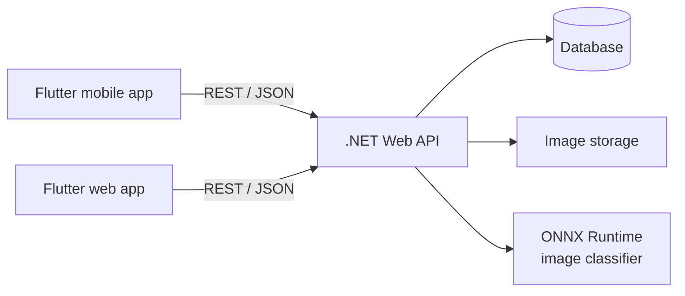

# AgriAI — AI Agriculture

> **Healthy Crops, Brighter Future** · محاصيل سليمة.. مستقبل أفضل

AgriAI is a mobile and web app that diagnoses diseases of strategic Egyptian crops — **tomato, wheat and rice** — from a photo of the leaf. The app returns the most likely diseases with a confidence score, explains each disease, and keeps a history of past diagnoses. The interface is bilingual (Arabic / English) with full RTL support.

A graduation project, Faculty of Computers and Information, Zagazig University.

## Core features

| # | Feature | What it does |
|---|---------|--------------|
| 1 | **AI Disease Diagnosis** | Pick a crop, take or upload a leaf photo, get the top predictions with confidence. Low-confidence results ask for a better photo. |
| 2 | **Disease Information** | Symptoms, causes, conditions, prevention and treatment steps, and a comparison with look-alike diseases. |
| 3 | **Diagnosis History** | Every diagnosis is saved with its image, result and date, and can be reopened later. |

Supporting: authentication, user profile, Arabic / English UI.

> Out of scope: weather-based risk forecasting. "Prediction" in this project means the model's prediction of the disease from the image.

## Architecture



- **ML** trains and evaluates the classifiers, then exports them to **ONNX**.
- **Backend (.NET)** exposes the REST API and runs the ONNX model in-process with ONNX Runtime.
- **Flutter** builds the mobile app (`mobile/`) and the website (`web/`) as two separate projects that call the same API.

## Repository layout

```
AI_AGRI/
├── ml/                 # AI team
│   ├── configs/  data/  notebooks/
│   ├── src/ (data, models, training, evaluation, export, inference)
│   ├── models/ (checkpoints, onnx)  experiments/  reports/  tests/
├── backend/            # .NET Web API (layered)
│   ├── src/ (Api, Application, Domain, Infrastructure)
│   └── tests/  docker/  scripts/
├── mobile/             # Flutter mobile app
│   ├── lib/ (core, features, l10n)  assets/  test/
├── web/                # Flutter website (same structure as mobile)
├── design/
│   ├── DESIGN.md       # shared design system
│   ├── mobile/screens/ # Stitch screens (8)
│   └── web/            # web design, to be created
├── docs/               # architecture, API contract, model spec, team workflow
└── .github/            # CODEOWNERS, pull request template
```

Each of `ml/`, `backend/`, `mobile/` and `web/` has its own README with the full folder tree and who works where.

## Design

The mobile UI was designed in Google Stitch. Screens are in [`design/mobile/screens`](design/mobile/screens), the web design will go in [`design/web`](design/web), and the shared design system is [`design/DESIGN.md`](design/DESIGN.md):

| Screen | File |
|--------|------|
| Home (crop selector, scan, history shortcut) | `01-home` |
| Scan / image input | `02-scan` |
| Diagnosis result | `03-diagnosis-result` |
| Disease information | `04-disease-info` |
| Comparison and prevention | `05-comparison-prevention` |
| Diagnosis history | `06-diagnosis-history` |
| Inspection details | `07-inspection-details` |
| Profile | `08-profile` |

Brand: Forest Canopy `#064E36`, Agricultural Growth `#087B55`, Plus Jakarta Sans (Latin) with Cairo / Tajawal (Arabic). See [`design/DESIGN.md`](design/DESIGN.md).

## Tech stack

| Area | Stack |
|------|-------|
| ML | Python, PyTorch or TensorFlow, ONNX |
| Backend | .NET, ASP.NET Core Web API, ONNX Runtime, Entity Framework Core |
| Mobile and Web | Flutter (two projects) |
| DevOps | Docker, GitHub |

## Team

| Team | Size | Responsibility |
|------|------|----------------|
| AI | 2 | Dataset prep, model training and evaluation, ONNX export |
| Backend (.NET) | 3 | Auth and database; disease info and history APIs; ONNX integration and deployment |
| Flutter | 2 | Mobile app and website |

Details in [`docs/TEAM_AND_WORKFLOW.md`](docs/TEAM_AND_WORKFLOW.md).

## Documentation

- [`docs/ARCHITECTURE.md`](docs/ARCHITECTURE.md): how the parts fit together
- [`docs/API_CONTRACT.md`](docs/API_CONTRACT.md): REST endpoints (draft)
- [`docs/MODEL_SPEC.md`](docs/MODEL_SPEC.md): the contract between ML and Backend
- [`ml/README.md`](ml/README.md): ML folders and model experiments plan
- [`backend/README.md`](backend/README.md), [`mobile/README.md`](mobile/README.md), [`web/README.md`](web/README.md): folder structure and ownership
- [`docs/TEAM_AND_WORKFLOW.md`](docs/TEAM_AND_WORKFLOW.md): roles, branches, reviews

## Status

Early development: mobile design done (web design pending), datasets collected, model experiments starting on tomato.
